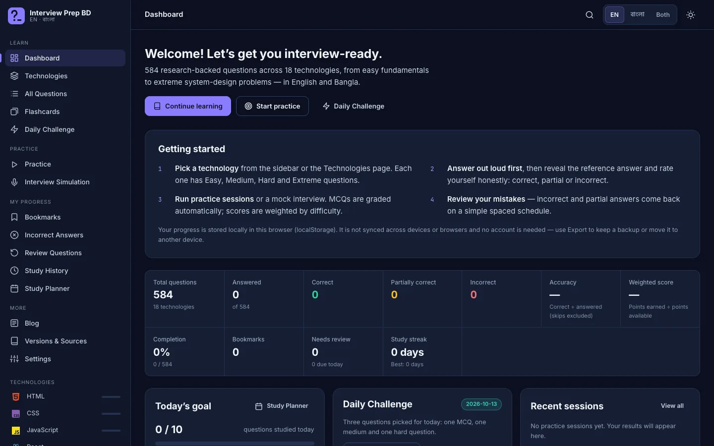
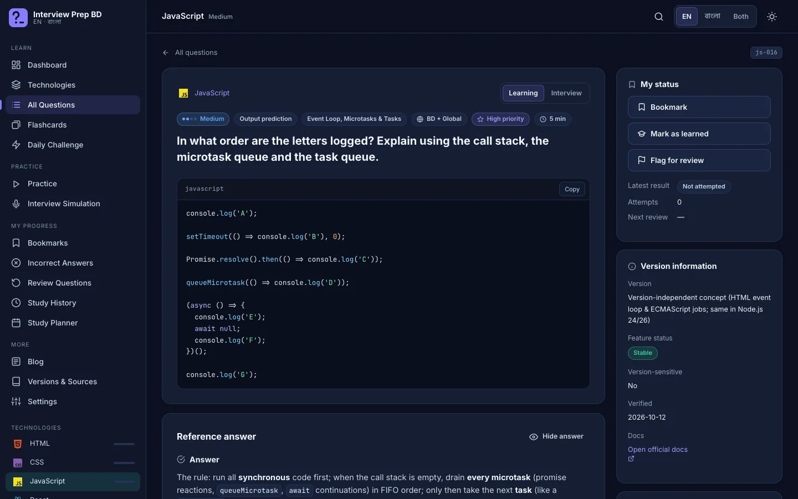
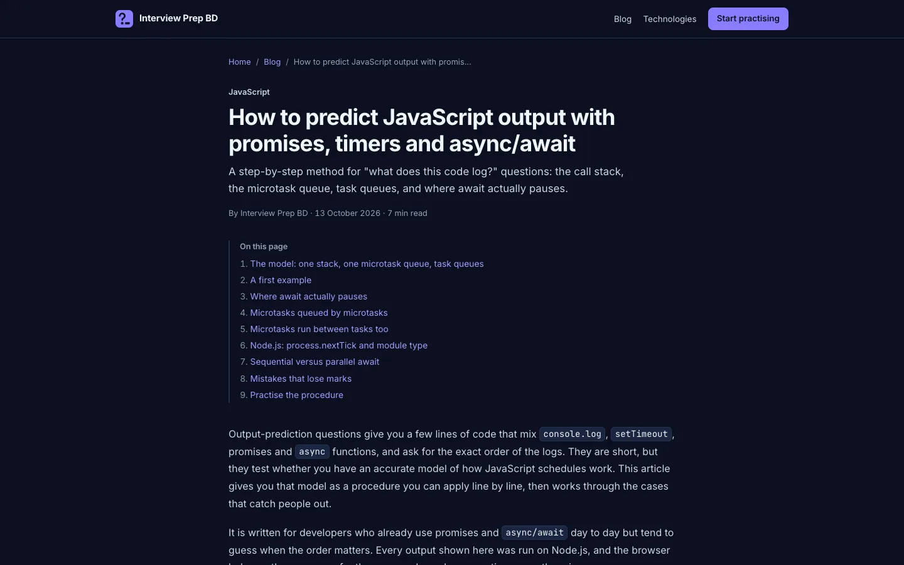

<p align="center">
  <picture>
    <source media="(prefers-color-scheme: dark)" srcset="assets/brand/logo-dark.svg">
    
  </picture>
</p>

<p align="center">
  <strong>Bilingual (English + বাংলা) technical interview practice for developers in Bangladesh and beyond.</strong><br>
  834 questions · 19 technologies + behavioural · works offline · no account · no backend
</p>

<p align="center">
  
</p>

Interview Prep BD is a browser-only interview-preparation app for developers in Bangladesh who also target international and remote roles. You answer real interview questions, reveal the reference answer, grade yourself honestly, and the app schedules weak questions for review. MCQs are graded automatically, practice sessions use difficulty-weighted scoring, and everything is available in English, Bangla or both side by side.

It's built with HTML, CSS and vanilla JavaScript. There is no framework, no backend, no build step to run it and no login. Progress stays in your browser.

## Contents

- [Quick start](#quick-start)
- [Features](#features)
- [Screenshots](#screenshots)
- [Question bank](#question-bank)
- [Project structure](#project-structure)
- [Public blog and SEO](#public-blog-and-seo)
- [Deploying](#deploying)
- [Development](#development)
- [Testing](#testing)
- [How the content was produced and checked](#how-the-content-was-produced-and-checked)
- [Limitations](#limitations)
- [Credits and trademarks](#credits-and-trademarks)

## Quick start

**Use the app offline:** download or clone the repository and double-click `index.html`. It works from `file://` in any modern browser (Chrome, Edge, Firefox or Safari, 2023 or later). The app itself only needs four files: `index.html`, `styles.css`, `app.js` and `questions.js`.

**Run the whole site locally (app + blog):**

```bash
git clone https://github.com/devshojol/Interview-prep-BD.git
cd Interview-prep-BD
python3 -m http.server 8000
```

Then open <http://localhost:8000> for the app and <http://localhost:8000/blog/> for the blog.

Fonts (Inter, Hind Siliguri, JetBrains Mono) load from Google Fonts when you're online. Offline, the app falls back to system fonts, including any installed Bangla font. Nothing else is fetched.

## Features

### Learn

- **Dashboard:** real stats calculated from your answers (accuracy, weighted score, completion, streak, items due for review), today's goal, recent sessions, per-technology progress, difficulty distribution, weak topics and the daily challenge.
- **Technologies:** 19 technologies plus a behavioural category, with question counts per difficulty, completion, search, sort and an area filter.
- **All Questions:** search in English or বাংলা, including tags and subtopics. Filter by technology, difficulty, type and market (Bangladesh, international or both). You can also show only bookmarked, incorrect, unanswered, learned or needs-review questions.
- **Quick answer + full answer:** every question opens with a 1–3 sentence quick answer (what you'd say first in an interview), followed by the full answer below it.
- **Quick recall:** 10 short fundamental questions per technology, plain viva-style answers with a tiny example, for fast revision before a written test or first round.
- **Behavioural & projects:** introducing yourself, walking through your project, the hardest bug, teamwork, deadlines and the questions to ask back, with sample answers you adapt.
- **Question detail:** Learning mode (answer shown) or Interview mode (hidden until you reveal it). Each question has code blocks with copy, expected output, explanation, common mistakes, an interview tip, follow-ups, official docs, version information, and related questions.

### Practise

- **Practice sessions:** presets (Quick 10, Focus 20, Deep 30) or custom filters, random or priority order, a question pool (all, unanswered, answered or mistakes) and an optional timer. Sessions survive reloads and language switches.
- **Interview simulation:** timed, answers hidden, questions ordered from easy to hard, auto-submits when time runs out.
- **Voice interviewer:** an English voice reads each question aloud in the interview simulation and daily challenge (and on demand everywhere else: question pages, practice and flashcards; press <kbd>V</kbd>). It uses the browser's built-in speech voices, so there's nothing to install, and you can pick the voice, speed and where questions are read automatically in Settings.
- **MCQs:** graded automatically with an explanation, and locked once scored.
- **Daily challenge:** three questions chosen from your local date: one MCQ, one medium and one hard.
- **Flashcards:** bilingual flip cards that show the quick answer, with decks (all, quick recall, not learned, bookmarked, due, mistakes), shuffle and keyboard control.

### Track

- **Scoring:** Easy 1, Medium 2, Hard 3, Extreme 4 points. Correct earns 100%, partial 50%, incorrect and skipped 0%. Weighted score = earned ÷ available. Accuracy = correct ÷ answered, excluding skips. Revealing an answer is never penalised.
- **Spaced review:** a transparent schedule. An incorrect answer comes back tomorrow and a partial one in 3 days. Each later correct answer moves it to the next interval in 1, 3, 7, 14 and 30 days, and after the 30-day review it leaves the queue.
- **Weak-topic detection:** miss rate = (incorrect + ½ partial) ÷ attempts, per subtopic and difficulty.
- **Study planner and history:** a daily target, a 7-day chart, an optional interview date with a suggested pace, a 16-week activity heatmap and every session's results.

### Your data

- Progress lives in `localStorage` under `ipbd:state`. It is versioned and migrated, and corrupted data is backed up instead of crashing the app.
- **Export / Import JSON** moves progress between browsers. Imports are validated and sanitised, and nothing is replaced until you confirm.
- **Reset progress** requires typing `RESET`. No account and no personal data are involved.

### Interface

- **Dark and light themes**, English / বাংলা / Both language modes, text size and reduced-motion settings.
- **Collapsible sidebar:** hover the sidebar edge or press <kbd>[</kbd>. In collapsed mode, every icon has a tooltip.
- **Keyboard shortcuts:** <kbd>/</kbd> search, <kbd>[</kbd> sidebar, and in questions <kbd>Space</kbd> reveal, <kbd>1</kbd>/<kbd>2</kbd>/<kbd>3</kbd> correct/partial/incorrect, <kbd>S</kbd> skip, <kbd>←</kbd>/<kbd>→</kbd> navigate, <kbd>B</kbd> bookmark, <kbd>F</kbd> flag.
- **Accessibility:**
  - semantic landmarks, a skip link and visible focus rings
  - ARIA on custom controls, a native `<dialog>` and live regions
  - colour is never the only signal
  - text alternatives for charts
  - a responsive layout with a mobile navigation drawer

## Screenshots

| Question detail | Blog article |
|---|---|
|  |  |

## Question bank

Counted from the actual records:

| Technology | Easy | Medium | Hard | Extreme | Main bank | MCQs | Quick recall |
|---|---:|---:|---:|---:|---:|---:|---:|
| HTML | 11 | 11 | 7 | 3 | 32 | 8 | 10 |
| CSS | 11 | 11 | 7 | 3 | 32 | 7 | 10 |
| JavaScript | 14 | 14 | 8 | 4 | 40 | 10 | 10 |
| React | 11 | 11 | 7 | 3 | 32 | 8 | 10 |
| Next.js | 11 | 11 | 7 | 3 | 32 | 8 | 10 |
| React Native (with Expo) | 14 | 14 | 8 | 4 | 40 | 10 | 10 |
| Node.js | 11 | 11 | 7 | 3 | 32 | 7 | 10 |
| Express.js | 11 | 11 | 7 | 3 | 32 | 7 | 10 |
| NestJS | 11 | 11 | 7 | 3 | 32 | 8 | 10 |
| MongoDB | 11 | 11 | 7 | 3 | 32 | 8 | 10 |
| Mongoose | 11 | 11 | 7 | 3 | 32 | 8 | 10 |
| PostgreSQL | 11 | 11 | 7 | 3 | 32 | 7 | 10 |
| SQL | 11 | 11 | 7 | 3 | 32 | 7 | 10 |
| Drizzle ORM | 11 | 11 | 7 | 3 | 32 | 7 | 10 |
| Redis | 11 | 11 | 7 | 3 | 32 | 8 | 10 |
| Vector Databases | 11 | 11 | 7 | 3 | 32 | 8 | 10 |
| Docker | 11 | 11 | 7 | 3 | 32 | 8 | 10 |
| NGINX | 11 | 11 | 7 | 3 | 32 | 9 | 10 |
| AWS | 11 | 11 | 7 | 3 | 32 | 7 | 10 |
| **Total** | **215** | **215** | **135** | **59** | **624** | **150** | **190** |

Plus **20 behavioural & project questions** (introducing yourself, walking through a project, hardest bug, teamwork, the salary conversation, questions to ask back), for **834** in total.

- **Quick layer:** every main-bank question has a 1–3 sentence quick answer (`quickAnswer`), and each technology has 10 quick-recall questions (`type: "quick"`, ids like `js-q01`) with plain viva-style answers.
- **Split (main bank):** 34% easy, 34% medium, 22% hard and 9% extreme. Extreme questions are senior-level material, not a requirement for junior roles.
- **By type (main bank):** MCQ 150, conceptual 122, scenario 73, debugging 61, coding 49, comparison 48, security/performance 31, database query 25, architecture 24, output prediction 23, system design 18. Plus 190 quick-recall and 20 behavioural questions.
- **By market:** both 705, Bangladesh 72, international 57.
- **Code and references:** 685 questions include code, and there are 1,692 documentation references (1,007 unique URLs).

Every record has English and Bangla text for the question, answer, quick answer (main bank), explanation, interview tip, follow-ups and MCQ options. It also carries `technologyVersion`, `verifiedAt`, `versionSensitive` (201 questions), `status` and `documentationUrl`.

<details>
<summary><strong>Verified versions (checked 2026-10-12)</strong></summary>

| Technology | Current stable used for content |
|---|---|
| HTML / CSS | HTML Living Standard; CSS Baseline status from web-features 3.42.0 (for example, anchor positioning is **not** Baseline yet) |
| JavaScript | ECMAScript 2026 (approved 2026-06-30) |
| React | 19.3.0 (React Compiler 1.0) |
| Next.js | 16.4.0 (Cache Components recommended; `proxy.ts` replaces the deprecated `middleware.ts`) |
| Node.js | 24.21.0 Active LTS · 26.11.1 Current (26 becomes LTS on 2026-10-28; annual releases from v27) |
| Express | 5.3.0 |
| NestJS | 12.1.3 |
| MongoDB | 9.0 (Node driver 7.7) |
| Mongoose | 9.11.1 |
| PostgreSQL | 18 (18.6); 19 is still in beta |
| Drizzle ORM | 0.45.4 stable (v1.0 is a release candidate, labelled *preview*) |
| Redis | Redis Open Source 8.10; node-redis 6.3, ioredis 6.0 |
| pgvector | 0.8.7 |
| Docker | Engine 29.9.0 · Compose v5.6.0 |
| NGINX | 1.30.5 stable · 1.31.6 mainline |
| AWS | Current services (Lambda `nodejs24.x` GA; Amazon Linux 2 end of support 2026-06-30) |

Versions came from the npm registry, nodejs.org, official release notes and docs. The full source list is on the in-app **Versions & Sources** page.

</details>

## Project structure

```text
.
├── index.html            # the app (works from file://)
├── styles.css            # design tokens + all app styles (also used by the blog)
├── app.js                # built from source/app/src/*.js; do not edit directly
├── questions.js          # the question bank (window.QBANK), built from source/data
├── blog/                 # generated static blog (do not edit; edit source/content)
├── 404.html              # generated, served by static hosts for unknown URLs
├── assets/
│   ├── brand/            # logo, mark, favicon, touch icon, default share image
│   ├── og/               # per-article share images (generated)
│   └── screenshots/      # README images
└── source/
    ├── app/src/          # app source, concatenated in filename order into app.js
    ├── data/             # question sources (src/*.py, json/*.json) and tech-icons.json
    ├── content/          # blog articles (blog/*.md) and site.json
    ├── blog-assets/      # blog.css and blog.js (copied into /blog by the build)
    ├── tools/            # build, validation and generation scripts
    ├── docs/             # authoring rules, verified facts, coverage plan, review checklist
    └── tests/e2e.mjs     # Playwright end-to-end + accessibility suite
```

## Public blog and SEO

`/blog/` is a separate, static, crawlable layer: plain HTML pre-rendered from Markdown by `source/tools/build_blog.py`, which uses only the Python standard library. Articles link into the app, for example to `/#/questions?tech=sql` or a specific question, but the app never depends on the blog.

**Articles published so far:**

- How to predict JavaScript output with promises, timers and async/await
- SQL JOIN and GROUP BY traps: WHERE vs HAVING, LEFT JOIN filters and NULL
- React useEffect explained: dependencies, stale closures and cleanup
- Error handling in Express 5: async routes, error middleware and 404s
- How to practise technical interview questions: answer aloud, grade honestly, review on a schedule

Every code example in these articles was executed (Node.js, PostgreSQL via PGlite, Express 5 and 4, React 19.3), and the articles show the real output.

**What the build produces:**

- **Pages:**
  - `blog/` and `blog/<slug>/`
  - `blog/page/N/` once there are more than 10 articles
  - `blog/category/<name>/` for categories with 3 or more articles
  - `blog/bn/<slug>/` for Bangla articles
  - an Atom feed, `sitemap.xml`, `robots.txt` and `404.html`
- **Metadata:** a unique title and description, canonical URL, Open Graph and Twitter tags, and per-article share images.
- **Structured data:** `BlogPosting`, `Blog`, `BreadcrumbList`, `WebSite` and `Organization` JSON-LD, built from the visible content.
- **Language and navigation:** `hreflang` for English and Bangla pairs, plus a table of contents on long articles.
- **Validation:** the build fails on missing fields, impossible dates, duplicate slugs, raw HTML, non-https links, links to drafts or unknown posts, and unknown question ids or app routes.

To write an article, see [`source/content/blog/README.md`](source/content/blog/README.md).

## Deploying

The repository root is the website, so any static host works: GitHub Pages, Netlify or Cloudflare Pages. The blog's clean URLs need a web server, while the app also works from `file://`.

> [!IMPORTANT]
> No production domain is configured yet, so the committed blog is a **preview build**: every page is `noindex`, and there is no canonical URL, JSON-LD, sitemap, robots.txt or feed. This keeps preview deploys from competing with the real site. Rebuild with your domain before going live.

```bash
cd source
python3 tools/build_og_images.py                               # only when article titles change (needs Chrome)
SITE_URL=https://your-domain.example python3 tools/build_blog.py
```

- `SITE_URL` must be https, and it may include a sub-path. With GitHub Pages on this repository, the address would be `https://devshojol.github.io/Interview-prep-BD`.
- You can set `"origin"` in `source/content/site.json` instead.
- On a sub-path, `robots.txt` isn't at the host root, so submit `sitemap.xml` in Google Search Console instead.

## Development

The app runs without a build. These scripts only regenerate files after you change their sources.

| Task | Command (run inside `source/`) |
|---|---|
| Rebuild `app.js` after editing `app/src/*.js` | `bash tools/build_app.sh`, then copy `app/app.js` to the repo root |
| Validate questions for one technology | `python3 tools/check.py <tech>` |
| Rebuild the question bank | `python3 tools/build_bank.py`, then copy `app/questions.js` to the repo root |
| Validate blog content only | `python3 tools/build_blog.py --check` |
| Build the blog (preview / production) | `python3 tools/build_blog.py` / `SITE_URL=… python3 tools/build_blog.py` |
| Regenerate share images | `python3 tools/build_og_images.py` (needs Chrome) |
| Refresh technology logos | `python3 tools/build_tech_icons.py <simple-icons dir> <devicon dir>` (see the script header) |

To add a question, add a `Q(...)` entry to `data/src/<tech>_bN.py`, then run `python3 data/src/<file>.py`, `python3 tools/check.py <tech>` and `python3 tools/build_bank.py`. The writing rules are in [`source/docs/AUTHORING.md`](source/docs/AUTHORING.md), and the verified facts in [`source/docs/FACTS.md`](source/docs/FACTS.md).

## Testing

`source/tests/e2e.mjs` is a Playwright suite that runs against the real files over `file://`. It needs `playwright` (or `playwright-core` with a local Chrome) and `axe-core`; set the `APP` and `AXE` paths at the top of the file. The latest run (2026-10-13) passed **103 of 103 checks**:

- **Navigation:** the app loads with no errors, every sidebar link works, and the Blog link points at the static blog.
- **Search and filters:** English and Bangla search, and filter counts checked against counts computed independently from the data.
- **Questions and sessions:**
  - Learning and Interview modes
  - independent bookmark, learned and review flags
  - exact scoring (a scripted session gives 1.5/4 points, 38% weighted, 33% accuracy)
  - skips, early endings and auto-submit
  - MCQs can't be scored twice
- **Storage:** corrupted, incompatible and legacy data never crash the app. Malformed or foreign imports are rejected, and HTML in imported data is never rendered.
- **Responsive and accessibility:**
  - no horizontal overflow at 390px and 768px across 16 routes in all three language modes
  - touch targets of at least 30px
  - an axe-core WCAG 2 A/AA audit with no critical or serious violations in either theme

The blog was checked separately:

- **axe:** clean on all pages at 1280px and 375px in both themes, with no horizontal overflow.
- **Crawl:** every page is reachable by links and matches the sitemap; canonical URLs and JSON-LD are valid; there's one h1 per page.
- **HTTP:** unknown URLs return a real 404.
- **External links:** all 12 documentation links resolved.

## How the content was produced and checked

1. **Research.** Versions came from official release notes, docs and the npm registry. Market context came from the Stack Overflow Developer Survey 2025, public Bangladesh interview reviews, a Bangladesh-focused JS interview article and a Bangladesh MERN/NestJS job post. Priority and market labels are editorial judgements, **not** frequency statistics.
2. **Writing.** Each category was written with an automated validator, and code was executed wherever possible:
   - JS and Node on Node 22, plus Node 24/26 for ES2026 features
   - SQL on PostgreSQL 16 and SQLite, with PostgreSQL 18-only syntax checked against its docs
   - pgvector 0.8, Redis with node-redis 6.3, and Express 5.3, NestJS 12.1 and Drizzle 0.45
   - HTML/CSS behaviour in headless Chromium
3. **Independent review.** A second technical review covered all 584 questions and made about 80 accuracy fixes. They included MCQ edge cases, CSS behaviour, Node graceful shutdown, Next.js caching, Mongoose 9 validators, Redis eviction, pgvector/EXPLAIN details, Compose v5 and AWS NAT gateways.

## Limitations

- **Self-assessment:** apart from MCQs, answers are graded by you against the reference answer. The app can't reliably grade free-form answers.
- **Local-only storage:** progress is per browser and per device, and clearing site data erases it. Export backups regularly.
- **Links:** not every one of the 853 unique documentation URLs was individually re-fetched.
- **Bangla review:** the Bangla was reviewed for technical fidelity, but not proofread by a native-speaker editor.
- **Content dates:** it reflects versions as of **12 Oct 2026**. Known upcoming changes are Node 26 LTS on 2026-10-28, Next.js 17 making Cache Components the default, and Drizzle v1 stable. Re-verify version-specific details before relying on them.
- **Standalone builder:** `source/tools/package.py` (the single-file standalone builder) still expects an older `app/` folder layout and doesn't include the blog yet.

## Credits and trademarks

- **Technology logos:** [Simple Icons](https://simpleicons.org) 16.33.0 (CC0-1.0), plus the AWS wordmark from [Devicon](https://devicon.dev) 2.17.0 (MIT). SQL and vector databases use generic symbols because neither has an official logo. All product names and logos are trademarks of their respective owners and are used only to identify the technologies.
- **Fonts:** [Inter](https://rsms.me/inter/), [Hind Siliguri](https://fonts.google.com/specimen/Hind+Siliguri) and [JetBrains Mono](https://www.jetbrains.com/lp/mono/), via Google Fonts.
- **Brand mark:** `?_`, a question waiting at a prompt for your answer. The files are in `assets/brand/`.
